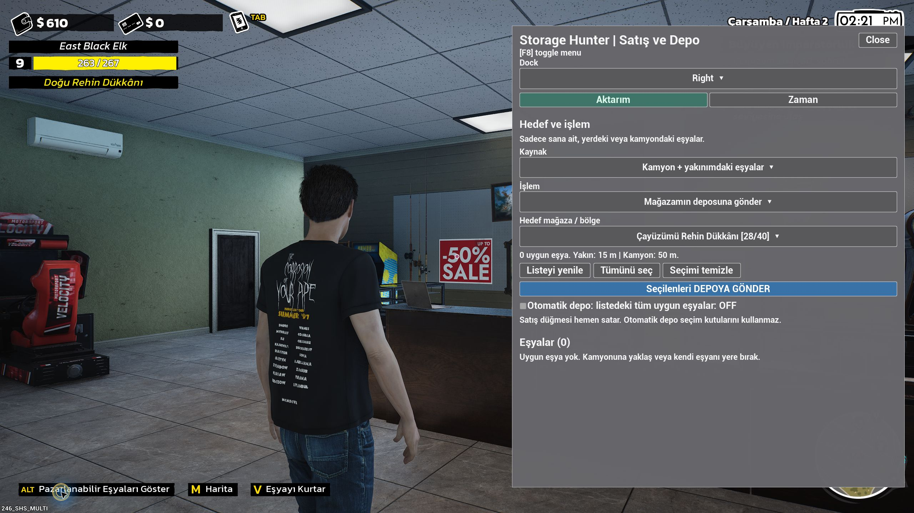

# StorageHunterAssist

**Storage Hunter Simulator için Türkçe satış, mağaza deposu ve zaman paneli.**

Kamyonundaki veya yakınındaki sana ait eşyaları seç; istediğin bölgedeki rehin dükkânında uzaktan sat ya da sahip olduğun mağazanın **deposuna** gönder. Yaygınları satıp diğer kaliteleri seçtiğin depoya ayırabilir, koleksiyonlukları ayrı seçebilir ve istersen otomatik işlemi açabilirsin. Zamanı da seçtiğin dakika kadar ilerletebilirsin.

[**Modu indir — v0.3.0**](https://github.com/LeventOnlyAi/StorageHunterAssist/releases/download/v0.3.0/StorageHunterAssist_0.3.0.zip) · [Sürümler](https://github.com/LeventOnlyAi/StorageHunterAssist/releases) · [English guide](docs/README.en.md)



## Neler yapar?

- **Eşya kaynağı seçimi:** Kamyon + yakınındaki eşyalar, yalnız kamyon veya yalnız yakın.
- **Hedef seçerek doğrudan satış:** Çayüzümü, Doğu, Batı, Zwiebel Çiftliği ve Naple rehin dükkânları.
- **Kendi mağazana depo aktarımı:** Hedef olarak yalnız sahip olduğun açık mağazalar listelenir. Eşyalar depo stokuna girer; raflara dizilmez.
- **Kaliteye göre ayırma:** Yaygınlar varsayılan olarak satılır; nadir, epik, efsanevi ve benzersiz ürünler seçtiğin depoya gönderilir. Hangi kalitelerin satılacağını kutucuklardan değiştir.
- **Kalite grupları:** Her kalitenin yanında ürün sayısı ve toplu seçim kutusu; altında tek tek ürün kutuları bulunur.
- **Koleksiyonluklar:** Kalite gruplarının altında koleksiyoncu adına göre ayrı listelenir. Bu hafta aranan, teslim edilmemiş ürünlerde yıldız bulunur. Kalite kuralları bu ürünleri satmaz.
- **Canlı liste:** Panel açıkken yaklaşık iki saniyede bir yenilenir; tek bir bozuk ürün diğerlerini gizlemez.
- **İsteğe bağlı otomatik işlem:** Ayırma modunda kurala göre satış / depo; depo modunda tüm uygun ürünleri depolama. Başlangıçta kapalıdır.
- **Ayarlanabilir zaman atlama:** 15, 30, 60, 120 veya 240 dakika; ayar dosyasından değiştirilebilir.
- **Türkçe panel:** `F8` ile açılır ve kapanır.

Satış oyunun kendi hızlı satış işlemini kullanır. Mağaza satın alımı, eşya sahipliği ve depo kapasitesi korunur. Başka bir satış modu kuruluysa onun fiyat / gelir kuralları da etkili olabilir.

## Gerekenler ve uyumluluk

| Gereken | Açıklama |
| --- | --- |
| Oyun | Windows üzerinde Storage Hunter Simulator. Aşağıdaki rehber Steam kurulumu içindir. |
| Oynanış | Tek oyunculu / host. Çok oyunculu istemci desteklenmez. |
| UE4SS | Oyun içinde doğrulanan sürüm: **v3.0.1-1181-g83330635**. |
| Mod paketi | Bu deponun Releases bölümündeki **StorageHunterAssist_0.3.0.zip**. |

Oyun içi doğrulama **build 22160137** ile yapıldı. Steam'in her yeni oyun güncellemesi için ayrıca uyumluluk garantisi verilmez. Kurulum yolu Steam'e göre anlatılır; bu, Steam'in güncel sürümünde ayrıca test yapıldığı anlamına gelmez. [Doğrulama kapsamı](docs/TESTING.md).

**ModMenu v1.4.0 arayüz kütüphanesi paketin içindedir.** Ayrıca ModMenu kurmana gerek yok. AutoStow, PawnShopAutoSellBoost veya başka bir Nexus modu da zorunlu değildir. UE4SS yükleyicisi ayrı indirilir; oyun dosyaları ve kayıt dosyaları bu pakete dahil değildir.

## Steam'e adım adım kurulum

### 1. Oyunu kapat ve kaydını yedekle

Oyunu normal şekilde kaydet ve tamamen kapat. Windows Dosya Gezgini'nin adres çubuğuna şu yolu yaz:

```text
%LOCALAPPDATA%\StorageHunter\Saved\SaveGames
```

`SaveGames` klasörünü başka bir yere kopyala. Bu, modu kurmadan önceki ilerlemene dönebilmen içindir. Oyunun kurulu olduğu Steam klasörüyle kayıt klasörü farklı yerlerdir.

### 2. Steam'den doğru oyun klasörünü bul

1. **Steam → Kütüphane** bölümünü aç.
2. **Storage Hunter Simulator** üzerine sağ tıkla.
3. **Yönet → Yerel dosyalara göz at** seçeneğine bas. İstersen **Özellikler → Yüklü Dosyalar → Göz At** yolunu da kullanabilirsin.
4. Açılan oyun klasöründe şu alt klasöre gir:

   ```text
   StorageHunter\Binaries\Win64
   ```

**Doğru yerde `StorageHunter-Win64-Shipping.exe` bulunmalı.** Oyunun en üst klasöründeki küçük `StorageHunter.exe` dosyasının yanına kurma.

Örnek tam yol şöyledir; Steam kütüphanen başka diskte olabilir:

```text
C:\Program Files (x86)\Steam\steamapps\common\Storage Hunter Simulator\StorageHunter\Binaries\Win64
```

Klasör adın örnekten farklıysa, esas alacağın yer Steam'in açtığı klasördeki **`StorageHunter-Win64-Shipping.exe` dosyasının bulunduğu konumdur**.

### 3. UE4SS yükleyicisini kur

1. [Test edilen UE4SS ZIP'ini resmî arşivden indir](https://github.com/UE4SS-RE/RE-UE4SS/releases/download/experimental/UE4SS_v3.0.1-1181-g83330635.zip). Bu bir deneysel sürümdür; burada belirli sürüme bağlantı verilir.
2. ZIP'i aç. İçindeki **`dwmapi.dll` dosyasını ve `ue4ss` klasörünü birlikte**, yukarıda bulduğun `Win64` klasörüne çıkar.
3. Sonuç aşağıdaki gibi olmalı:

   ```text
   Win64/
   ├── StorageHunter-Win64-Shipping.exe
   ├── dwmapi.dll
   └── ue4ss/
       ├── UE4SS.dll
       ├── UE4SS-settings.ini
       └── Mods/
   ```

ZIP'in dışına fazladan `UE4SS_v...` adlı klasör açıp bütün dosyaları onun içine bırakma. `dwmapi.dll` doğrudan oyun EXE'sinin yanında olmalıdır.

UE4SS zaten kuruluysa `Mods`, `mods.txt`, `mods.json` ve ayarlarını önce yedekle. Sırf bu modu eklemek için mevcut mod listenin tamamını hazır bir dosyayla değiştirme. Eski `Win64\Mods` düzeni kullanıyorsan bu rehberdeki yeni `Win64\ue4ss\Mods` düzeniyle karıştırma.

Resmî kaynaklar: [UE4SS kurulum rehberi](https://docs.ue4ss.com/dev/installation-guide.html), [UE4SS deneysel sürüm arşivi](https://github.com/UE4SS-RE/RE-UE4SS/releases/tag/experimental).

### 4. StorageHunterAssist klasörünü yerleştir

1. Sayfanın başındaki **Modu indir** bağlantısından `StorageHunterAssist_0.3.0.zip` dosyasını indir.
2. ZIP'in içindeki **`StorageHunterAssist` klasörünü** şu konuma kopyala:

   ```text
   Win64\ue4ss\Mods\
   ```

3. En önemli dosya şu tam düzende görünmeli:

   ```text
   Win64\ue4ss\Mods\StorageHunterAssist\Scripts\main.lua
   ```

`StorageHunterAssist\StorageHunterAssist\Scripts` gibi iki kez iç içe klasör olmamalı.

**GitHub'ın yeşil Code → Download ZIP seçeneği kaynak kodunu indirir.** Kolay kurulum için Releases altındaki mod ZIP'ini kullan. Kaynak ZIP'ini indirdiysen içindeki `mod\StorageHunterAssist` klasörü kurulacak klasördür; deponun tamamını oyuna kopyalama.

### 5. Modu etkinleştir

`Win64\ue4ss\Mods\mods.txt` dosyasını Not Defteri ile aç. Diğer satırları koruyarak şu satırı ekle veya varsa değerini `1` yap:

```text
StorageHunterAssist : 1
```

UE4SS paketindeki `Keybinds : 1` satırı varsa onu en altta bırak; yeni satırı onun üstüne ekle. Dosya adının yanlışlıkla `mods.txt.txt` olmadığını kontrol et.

Aynı klasörde **`mods.json` da varsa**, diğer kayıtları koruyarak listeye şu mod kaydını ekle veya mevcut kaydı etkinleştir:

```json
{
  "mod_name": "StorageHunterAssist",
  "mod_enabled": true
}
```

Bu, **JSON listesinin içine eklenecek bir kayıt** örneğidir; tüm dosyayı bununla değiştirme. Önceki kayıtla arasına virgül koy; son kayıttan sonra fazladan virgül bırakma. `mods.json` hiç yoksa sırf bu mod için oluşturman gerekmez.

### 6. Oyuna gir ve F8'e bas

Oyunu **Steam'deki Oyna düğmesiyle** normal şekilde başlat. Kayıtlı oyununu yükle; ana menüde değil, karakterinle dünyaya girdikten sonra **F8**'e bas.

Sağ tarafta **Storage Hunter | Kalite ve Koleksiyon** paneli açılır. Steam başlatma seçeneklerine bu mod için özel bir komut yazman gerekmez.

## Panel nasıl kullanılır?

### Yaygınları sat, diğer kaliteleri depoya gönder

1. **F8 → Aktarım** sekmesinde kaynağı seç: kamyon + yakın, yalnız kamyon veya yalnız yakın.
2. **İşlem → Kaliteye göre ayır: SAT / DEPO** seç. Bu varsayılan moddur.
3. **Depo mağazam** alanından ürünlerin gideceği kendi açık mağazanı seç.
4. **Kaliteye göre ayırma: satış bölgesi** alanından yaygınların satılacağı rehin dükkânını seç. Depo ve satış hedefleri birbirinden bağımsızdır.
5. **Eşyalar** sekmesine geç. Yaygın / nadir / epik gibi başlığın kutusu o gruptakileri topluca seçer. Altındaki kutulardan ürünleri ayrı da seçebilirsin. **Tümünü seç** koleksiyonluklar dahil bütün listelenenleri işaretler.
6. **Aktarım** sekmesine dön. `1 sat / 2 depo / 1 beklet` gibi özet, seçilen ürünlere kalite kuralının ne yapacağını gösterir.
7. **Seçilenleri KALİTEYE GÖRE AYIR** düğmesine bas. İşlem hemen başlar.

**Kurallar** sekmesinde işaretli kalite **SATILIR**; işaretsiz kalite seçtiğin **DEPOYA** gider. Varsayılan olarak yalnız **Yaygın ürünleri SAT** işaretlidir. Eşya kondisyonu ile nadirlik farklıdır; kutular nadirlik değerini kullanır. Oyunda kalitesi henüz bilinmeyen veya koleksiyon verisi okunamayan ürün ayırmada **bekletilir**. Satılacak ürün önce oyunda doğrulanmış olmalıdır: doğrulanmamış ürün `Doğrulanmadı: satış bekler` etiketiyle bekler; mod otomatik doğrulama yapmaz. Bu kontrol, native hızlı satışta doğrulanmamış ürünü sıfır bedelle çıkarma durumunu önler.

Depo ayağı önce yapılır. Tüm seçili depo ürünlerine yer yoksa işlem başlamaz ve satış da yapılmaz. Depo eşya reddederse işlem durur; daha önce kabul edilmiş ürünler depoda kalır, satış ayağı başlatılmaz. Yerel oyun hatası veya hedef değişimi halinde tam geri alma garantisi yoktur; sonucu kontrol et.

### Koleksiyonluk ürünleri seçme

**Eşyalar** sekmesinde kalite gruplarının altında **KOLEKSİYONLUKLAR** bulunur. Örneğin **Koleksiyonluk — Arkeolog (2)** kutusu o koleksiyoncunun iki ürününü seçer. Her ürünün kalitesi ve bulunduğu kaynak da satırında yazar.

**★ BU HAFTA ARANIYOR**, oyunun o haftaki listesinde bulunan ve henüz teslim edilmemiş ürün demektir. Yıldız olmayan koleksiyonluklar da ayrı listede korunur. Bu bilgi, koleksiyoncunun ürünü şu anda kesin kabul edeceği veya ürün doğrulamasının tamamlandığı anlamına gelmez.

Kaliteyle ayırmada koleksiyonluklar varsayılan olarak **bekletilir**. İstersen **Kurallar → Koleksiyonlukları bekletmek yerine seçtiğim DEPOYA gönder** kutusunu aç. Bu kutu onları satmaz. Koleksiyoncuya teslimi oyunun normal ekranından yap; koleksiyoncular uzaktan satış hedefi değildir.

### Seçilenlerin hepsini depoya gönderme veya satma

- Depolama için **İşlem → Hepsini mağazamın deposuna gönder**, ardından **Depo mağazam** alanından kendi hedef mağazanı seç. **Eşyalar** sekmesinde seçip **Aktarım → Seçilenleri DEPOYA GÖNDER** düğmesine bas.
- Satış için **İşlem → Hepsini satış noktasında doğrudan sat** seç. Aynı hedef alanından satış bölgesini seç; ürünleri işaretleyip **Seçilenleri SAT** düğmesine bas.

Bu iki mod kalite kurallarını kullanmaz. **SAT modu, elle seçtiğin koleksiyonlukları da hemen satar.** Depo aktarımı raflara yerleştirmez; normal depo stokunu ve kapasitesini kullanır. `[22/40]`, 40 kapasitenin 22'sinin dolu olduğunu gösterir.

Satış oyunun hızlı satışını kullanır. Nakit / banka payı normal oyun hesabına göre dağıtılır. Gösterilen nakit değişimi toplam satış tutarı değildir. Beş hedef: **Çayüzümü, Doğu, Batı, Zwiebel Çiftliği, Naple**. Koleksiyoncular ve uzmanlar satış hedefi değildir; pazarlık ekranı açılmaz.

### Otomatik işlem

Otomatik **kapalı başlar**. Kaynağı, hedefleri ve kuralları ayarladıktan sonra **Aktarım → Otomatik: kaynakta bulunan tüm uygun ürünlere uygula** kutusunu aç.

- **Ayırma modunda otomatik SATIŞ DA YAPAR.** İşaretli kaliteler satılır, diğerleri depoya gider. Koleksiyonluklar seçtiğin koruma / depo kuralını izler; bilinmeyenler bekler.
- **Depo modunda** tüm uygun ürünleri hedef depoya gönderir. Doğrudan SAT modunda otomatik açılamaz.
- Tek tek ürün seçim kutularına bakmaz; seçili kaynaktaki **tüm uygun ürünlere** yaklaşık iki saniyede bir uygulanır.
- Panel kapalıyken de sürer. Kaynak / işlem / hedef / kalite kuralı değişince kapanır. Dolu veya reddeden depo, başarısız işlem ve oyun yeniden açılışı da otomatiği kapatır.
- Kapatmak için aynı kutuyu kapat. Kurallar ve hedefler bu sürümde yalnız o oyun oturumu boyunca tutulur.

### Hangi eşyalar görünür?

Yakındaki yerdeki eşyalarda **15 metre**, kamyon kasasında **50 metre** mesafe kullanılır. Yalnız sana ait uygun ticari eşyalar görünür. Aynı ürün kamyon ve yakında iki kez sayılmaz.

Eline aldığını önce bırak. Satın alınmamış / başkasına ait ürünler, raf ürünleri, zaten depoda olanlar ve kutu içindeki alt ürünler ayrı işlenmez. Panel açıkken liste kendini yeniler; yenileme mevcut ürün seçimlerini korur ve yeni ürünü kendiliğinden seçmez. İstersen **Listeyi yenile** düğmesini de kullan.

Oyun bir satış / depo işleminden sonra aynı aktörü yeniden kullanırsa, onaylanmış eski işlem kaydı doğal sahiplik / depo değişiminde temizlenir; yeni ürün kalıcı olarak gizlenmez. Sonucu belirsiz motor hataları otomatik tekrar denenmez.

Tek bir ürünün adı okunamazsa kimliği gösterilir; geçersiz ürün diğerlerinin taranmasını engellemez. Boş listede sahiplik / elde / kutu / raf / depo nedeniyle dışarıda kalan ürünler için açıklama gösterilebilir. Bu sürüm bütün görünmeme nedenlerinin giderildiği iddiasında değildir; hareket veya bırakma sonrası birkaç saniye bekleyip doğru kaynağı kontrol et.

## Zaman tuşları

| Tuş | Görev |
| --- | --- |
| **F8** | Satış / Depo panelini aç veya kapat. |
| **F6** | Seçili dakika kadar zamanı ileri al. Başlangıçta 60 dakika. |
| **F7** | 15 / 30 / 60 / 120 / 240 dakika arasında geçiş yap. |
| **F5** | Kısa tuş yardımını göster. |

Panelin **Zaman** sekmesinden de süreyi seçip düğmeyle ilerletebilirsin. Atlama gün sonundan önce durur; sonraki güne geçmek için oyunun normal uyuma işlemini kullan.

## Ayarları değiştirme

Oyun kapalıyken şu dosyayı aç:

```text
Win64\ue4ss\Mods\StorageHunterAssist\Scripts\sh_assist_config.lua
```

```lua
TimeSteps = {15, 30, 60, 120, 240}, -- F7 ile dolaşılan dakika değerleri
DefaultStep = 60,                -- başlangıç seçimi
NearRangeCm = 1500,              -- 15 metre; değer santimetre
TruckRangeCm = 5000,             -- 50 metre; değer santimetre
AutoDepositPollMs = 2000,        -- kontrol aralığı; milisaniye
```

Örneğin `NearRangeCm = 2000` yazarsan yakın eşya mesafesi 20 metre olur. Zaman adımlarını 1–1440 arasında tam dakika olarak yaz ve listeyi boş bırakma. Kontrol aralığı en az 1000 ms olmalıdır. Dosyadaki virgülleri ve süslü parantezleri koru. `DayStartHour` ve `LastMinuteOfDay` oyunun gün sonu hesabı içindir; normal kullanımda değiştirme. Kaydet, ardından oyunu yeniden başlat.

## Sorun giderme

| Sorun | Kontrol et |
| --- | --- |
| F8 hiçbir şey açmıyor | Kayıt yüklenmiş olmalı. Klasör düzenini ve `mods.txt` / varsa `mods.json` kaydını kontrol et. Başka bir mod F8'i kullanıyorsa çakışmayı gider. |
| Hiç eşya görünmüyor | Kamyona yaklaş; elindeki eşyayı bırak; doğru kaynağı seç; Listeyi yenile'ye bas. Eşyanın sana ait olması gerekir. |
| Depo hedefi yok | Satın aldığın, açık bir mağaza deposu bulunmalı. Satış işlemi ile depo işleminin hedef listesi farklıdır. |
| Depoya gitmiyor | Hedef kapasitesini ve durum mesajını kontrol et. Eşya listelendikten sonra yer değiştirdiyse tekrar tara. |
| Otomatik kapalı | Kaynak / işlem / hedef / kural değişikliği, oyun yeniden açılışı veya kabul edilmeyen işlem otomatiği kapatabilir. Doğrudan SAT modunda açılamaz. |
| Oyun güncellemesinden sonra çalışmıyor | Önce modu kapat; oyun ve UE4SS sürümünü not ederek issue aç. Başka oyun build'leri uyarlama gerektirebilir. |

UE4SS günlüğü şu konumdadır:

```text
Win64\ue4ss\UE4SS.log
```

Yükleme satırında `[StorageHunterAssist] v0.3.0 loaded` görülmesi modun yüklendiğini gösterir. Günlük hiç oluşmuyorsa önce UE4SS kurulumunu kontrol et. Yardım isterken oyun build'ini, UE4SS sürümünü, hangi düğmeye bastığını ve ilgili hata satırlarını paylaş; kayıt dosyanı veya bütün günlüğünü herkese açık göndermen gerekmez.

## Güncelleme ve kaldırma

**Güncelleme:** Oyunu kapat, kendi `sh_assist_config.lua` ayarlarını yedekle, yeni ZIP'teki `StorageHunterAssist` klasörünü mevcut mod klasörünün yerine koy. Mod etkinleştirme kaydını tekrar tekrar ekleme. Sürüm notlarında ayar değişikliği varsa eski ayarlarını ona göre uyarla.

**Sadece bu modu kapatma:** Oyun kapalıyken `mods.txt` içindeki `StorageHunterAssist : 1` değerini `0` yap. `mods.json` varsa aynı modun `mod_enabled` değerini de `false` yap. Sonra oyunu yeniden başlat.

**Tamamen kaldırma:** Oyunu kapat. `StorageHunterAssist` klasörünü `ue4ss\Mods` dışına taşı veya sil; bu moda ait satırları mod listelerinden kaldır. Diğer modları kullanıyorsan UE4SS dosyalarını bırak. Modu kaldırmak daha önce yaptığın satışları, aktarımları veya zaman atlamalarını geri almaz; o işlemlere dönmek için kendi kayıt yedeğini kullan.

## Lisans ve kaynaklar

Özgün mod kodu [MIT lisanslıdır](LICENSE). Paketteki **ue4ss-ModMenu v1.4.0** için Matthew arvidson'ın MIT lisansı korunmuştur; [üçüncü taraf bildirimi](THIRD_PARTY_NOTICES.md). UE4SS ve oyunun kendisi ayrı projelerdir. Bu proje oyun geliştiricisi, Valve veya UE4SS ekibi tarafından yayımlanmış resmî bir ürün değildir.
